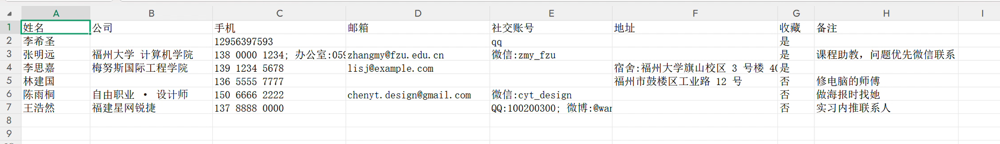
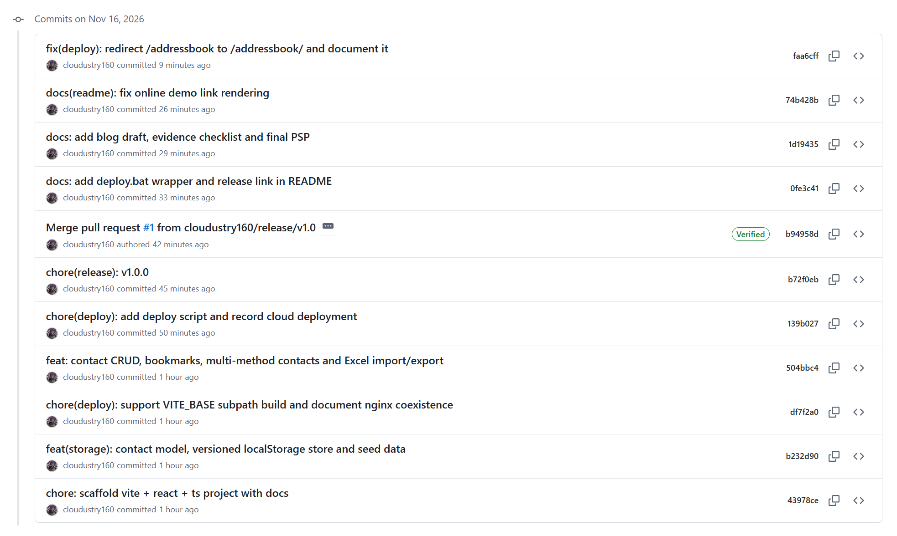

# 通讯录 Address Book

EE308FZ Software Engineering · Extreme Programming 个人作业

一个纯前端通讯录：联系人增删改查、**收藏**、**多联系方式**、**Excel 导入导出**、搜索筛选。数据保存在浏览器 `localStorage`，不需要后端、数据库或环境变量。

## 在线演示

访问地址：[http://114.55.128.202/addressbook/](http://114.55.128.202/addressbook/)

若暂时打不开，按下面「快速开始」本地运行即可。

- 版本：`v1.0.0`（[Release 说明](https://github.com/cloudustry160/-StarNote-Contact-Manager/releases/tag/v1.0.0)）
- 演示视频（2 分 21 秒）：[demo.mp4](docs/media/demo.mp4)
- 部署方式：阿里云服务器 + Nginx 子路径，与同机其他服务共存

## 功能

| 功能 | 说明 |
| --- | --- |
| 收藏联系人 | 卡片星标一键切换、详情页同步；「收藏」标签页筛选；收藏优先排序；刷新后保留 |
| 多联系方式 | 一个联系人可挂任意多条：手机 / 邮箱 / 社交账号 / 地址 / 其他；可自定义标签（微信、办公室、宿舍…）、可设主要联系方式 |
| Excel 导出 | 一行一位联系人，列头固定；同类多值用 `; ` 分隔；自定义标签写成 `标签:值` |
| Excel 导入 | 表头别名容错、逐行校验、预览前 8 行、重复策略（跳过 / 覆盖）、失败行定位到行号 |
| 搜索 | 姓名、公司、备注、任意联系方式的值，实时过滤 |
| 响应式 | 桌面双列、移动单列，空状态与错误提示齐全 |

## 界面预览

| 列表（收藏星标） | 新增联系人（多联系方式） |
| --- | --- |
|  |  |

| 收藏标签页 | 搜索 |
| --- | --- |
|  |  |

| 导出的 Excel | GitHub 提交历史 |
| --- | --- |
|  |  |

更多截图见 [docs/screenshots](docs/screenshots)，演示视频见 [docs/media/demo.mp4](docs/media/demo.mp4)。

## 快速开始

要求：Node.js ≥ 20。

```bash
npm ci
npm run dev        # http://localhost:5173
```

生产构建与自测：

```bash
npm run build      # 类型检查 + 打包到 dist/
npm test           # 19 个单元测试
```

首次打开会写入 5 条示例联系人，便于直接体验；数据只存在你自己的浏览器里。

## Excel 格式

导出的文件可以直接作为导入模板（`sample/contacts-template.xlsx` 也是同一格式）：

| 姓名 | 公司 | 手机 | 邮箱 | 社交账号 | 地址 | 收藏 | 备注 |
| --- | --- | --- | --- | --- | --- | --- | --- |
| 张三 | 示例公司 | 13800000000; 办公室:0591-22860001 | zhangsan@example.com | 微信:zhangsan_wx | 福州市鼓楼区工业路 12 号 | 是 | 可删除本行 |

- 一行一位联系人，「姓名」列必需。
- 同类型多个值用分号分隔（`;` 或 `；`）。
- 想保留自定义标签时写成 `标签:值`，例如 `办公室:0591-22860001`；不写标签则用该列默认标签。
- 「收藏」列接受 `是/否`、`true/false`、`1/0`，留空按否。
- `sample/contacts-demo.xlsx` 里有 20 条正常数据和 2 条故意错误的数据（坏手机号、缺姓名），可用来演示校验。

## 项目结构

```
src/
├─ types.ts                 # 领域类型与常量
├─ storage/                 # localStorage 读写、校验、示例数据
├─ hooks/useContacts.tsx    # Context + reducer + 防抖落盘
├─ features/
│  ├─ contacts/             # 列表、详情、表单、多联系方式、收藏、搜索
│  └─ excel/                # 导出、解析与校验（纯函数 + 单测）、导入弹窗
├─ components/              # Layout、Toast、ConfirmDialog、样式常量
└─ App.tsx / main.tsx
scripts/make-samples.mjs    # 生成 sample/ 下的 Excel 文件
docs/                       # 编码规范、PSP、实现与验收说明
```

## 部署

线上环境：阿里云轻量服务器 + Nginx，与同机的计算器服务共存（子路径 `/addressbook/`）。

一键重新部署（Windows，双击或命令行）：

```
scripts\deploy.bat
```

它等价于：

```bash
VITE_BASE=/addressbook/ npm run build
tar -czf deploy.tar.gz -C dist .
scp deploy.tar.gz root@<服务器>:/tmp/
ssh root@<服务器> "rm -rf /var/www/addressbook && mkdir -p /var/www/addressbook && tar -xzf /tmp/deploy.tar.gz -C /var/www/addressbook"
```

Nginx 在现有 `server` 块里加：

```nginx
location /addressbook/ {
    root /var/www;
    try_files $uri $uri/ /addressbook/index.html;
}
```

详细步骤、备份与回滚见 [docs/IMPLEMENTATION.md](docs/IMPLEMENTATION.md)。

## 文档

- [编码规范](docs/CODE_STYLE.md)
- [PSP 表](docs/PSP.md)
- [实现过程与助教验收](docs/IMPLEMENTATION.md)
- [博客正文草稿](docs/BLOG.md)
- [截图与视频清单](docs/EVIDENCE.md)
- [验收指南（给助教）](REVIEW.md)

## 已知限制

- 数据保存在浏览器本地，换设备/换浏览器不同步（设计选择：零部署依赖）。
- 清空浏览器数据会丢失联系人，请用「导出」备份。
- 导入只读取第一个工作表。

## 作者

个人作业 · 2026 秋
