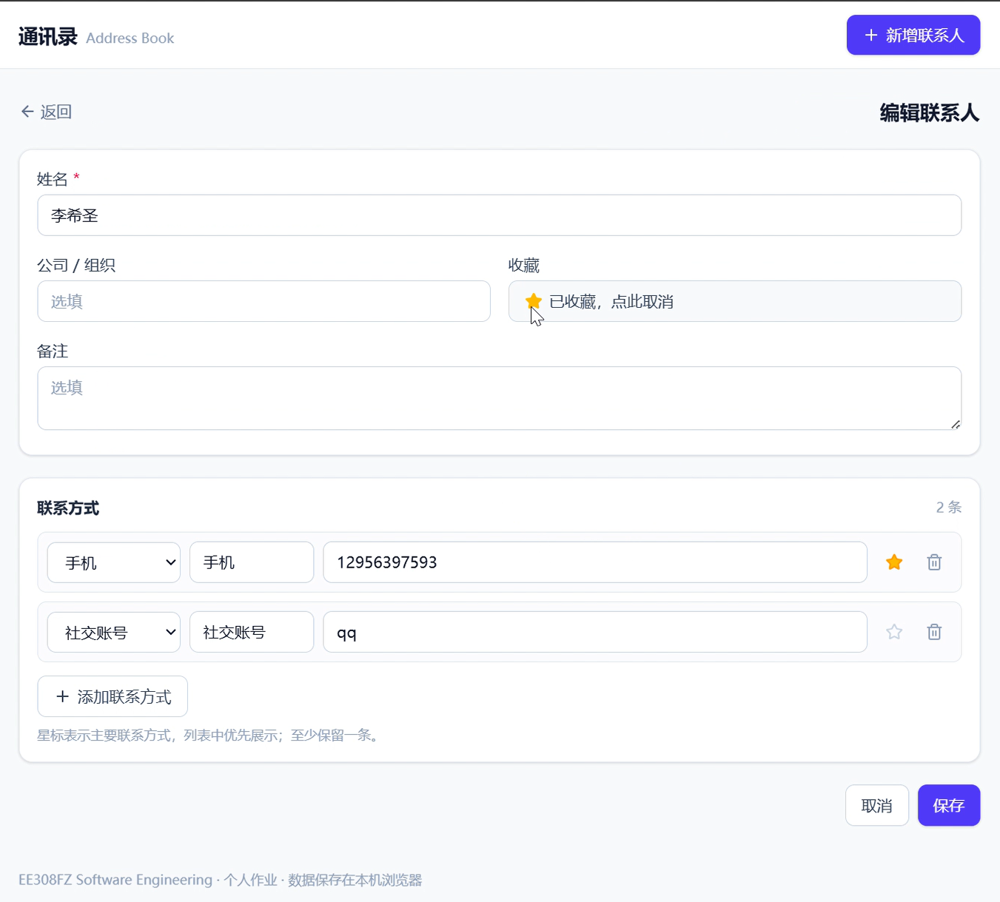
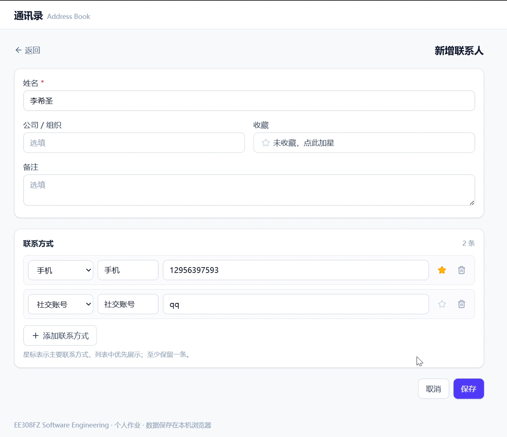
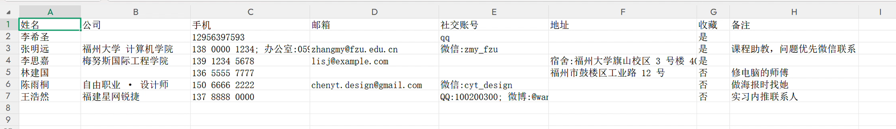
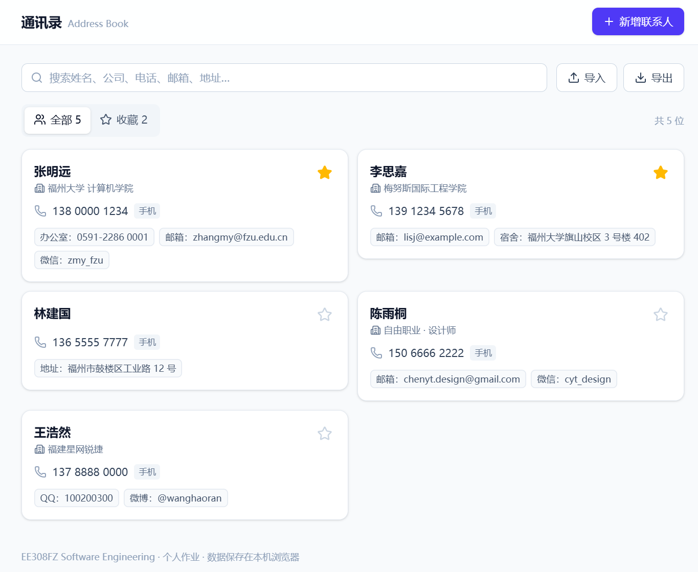
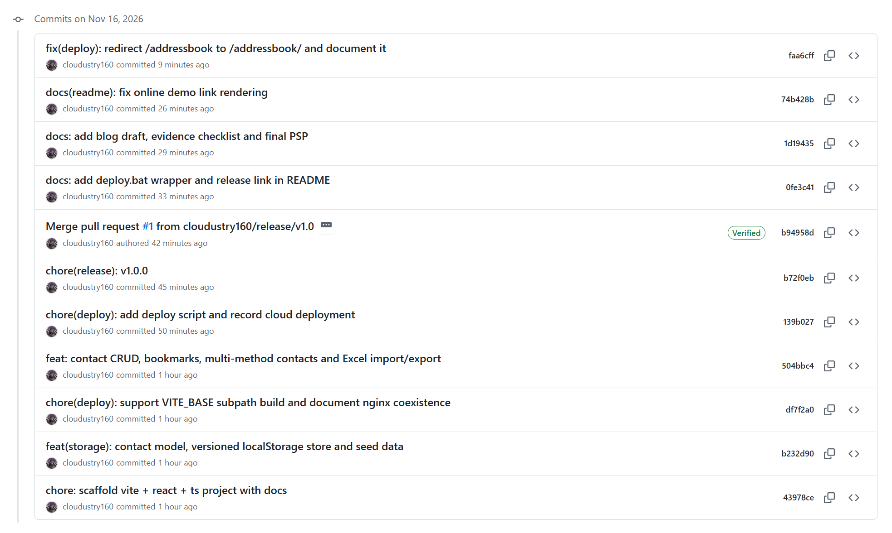
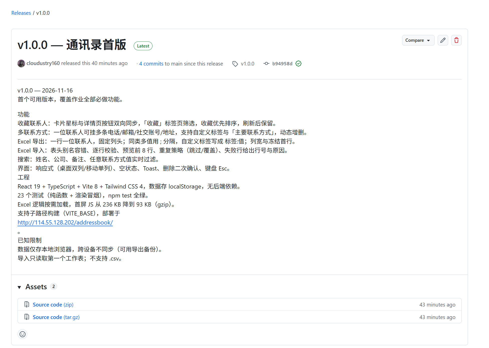

# EE308FZ Software Engineering · Extreme Programming Individual Assignment: 通讯录 (Address Book)

## Assignment Information

| Item | Content |
| --- | --- |
| Course | [2601_FZU-MU_SE](https://bbs.csdn.net/forums/2601_MU_SE_FZU) |
| Team name | Individual assignment (solo) |
| Assignment requirements | [Extreme Programming (Deadline: November 17, 2026, 23:59)](https://bbs.csdn.net/topics/620593436) |
| Objectives | Implement bookmarked contacts, multiple contact methods and Excel import/export; go through the full requirement → design → coding → testing → deployment → documentation cycle |
| Division of work & contribution | All modules (requirements, frontend, Excel, testing, deployment, docs) completed by myself; 100% |
| Other references | React / Vite / Tailwind CSS / SheetJS documentation; similar posts in the CSDN community |

## Table of Contents

1. [Project Links](#1-project-links)
2. [Features and Implementation](#2-features-and-implementation)
3. [Tech Stack and Project Structure](#3-tech-stack-and-project-structure)
4. [How to Run and Verify](#4-how-to-run-and-verify)
5. [Git Evidence](#5-git-evidence)
6. [Problems and Solutions](#6-problems-and-solutions)
7. [PSP Table](#7-psp-table)
8. [Demo Video and Screenshots](#8-demo-video-and-screenshots)
9. [Limitations and Next Steps](#9-limitations-and-next-steps)

---

## 1 Project Links

| Type | Link |
| --- | --- |
| GitHub repository | https://github.com/cloudustry160/-StarNote-Contact-Manager |
| Live site (cloud deployment) | http://114.55.128.202/addressbook/ |
| Coding standard | https://github.com/cloudustry160/-StarNote-Contact-Manager/blob/main/docs/CODE_STYLE.md |
| Release | https://github.com/cloudustry160/-StarNote-Contact-Manager/releases/tag/v1.0.0 |
| Reviewer guide | https://github.com/cloudustry160/-StarNote-Contact-Manager/blob/main/REVIEW.md |
| Demo video | https://github.com/cloudustry160/-StarNote-Contact-Manager/blob/main/docs/media/demo.mp4 |

Scale: 24 source files, about 1,944 lines of TypeScript / TSX, 23 test cases, 12 commits, version `v1.0.0`.

---

## 2 Features and Implementation

### 2.1 Bookmarked Contacts (25 points)

**Key points**:

- `favorite: boolean` lives on the contact record and is written to `localStorage` together with it, so the state survives a refresh.
- The star on the list card, the bookmark switch on the edit page and the detail page all call the same `toggleFavorite(id)` — no duplicated state to drift apart.
- The "收藏" (Favorites) tab only filters, it does not copy data: filter by `favorite` first, then sort, so bookmarked contacts always float to the top.

```ts
export function filterContacts(contacts: Contact[], { query, onlyFavorites }: FilterOptions): Contact[] {
  return contacts
    .filter((c) => (onlyFavorites ? c.favorite : true))
    .filter((c) => matchesQuery(c, query))
    .sort((a, b) => {
      if (a.favorite !== b.favorite) return a.favorite ? -1 : 1; // bookmarked first
      return b.updatedAt.localeCompare(a.updatedAt);            // then most recently updated
    });
}
```

The bookmark switch on the edit page reads「已收藏，点此取消」when the contact is bookmarked:



After switching to the「收藏」tab, only 3 of the 6 contacts remain, ordered with bookmarks first:


### 2.2 Multiple Contact Methods (10 points)

**Key points**:

- `Contact.methods` is an array; each entry holds `id / kind / label / value / primary`.
- `kind` is one of five fixed types (phone, email, social account, address, other), while `label` is free text —「微信」,「办公室」,「宿舍」and so on.
- The form uses dynamic rows: when the type changes and the label is still the default, the label follows; any row can be marked as primary, and any row can be deleted.
- Validation before saving: name is required and at least one method must be filled in. Phone and email get soft warnings only — a real contact may have an extension number.

Below, 李希圣 has both a phone number and a social account, with the phone marked as the primary method (the filled star):



### 2.3 Excel Export (one half of the 25 points)

**Key points**: the header row is fixed to `姓名 | 公司 | 手机 | 邮箱 | 社交账号 | 地址 | 收藏 | 备注`. Multiple values of the same kind are joined with `; `, and custom labels are written as `标签:值`, so「办公室:0591-…」and a plain phone number can coexist in one cell.

```ts
export function cellFor(contact: Contact, kind: MethodKind): string {
  return contact.methods
    .filter((m) => m.kind === kind && m.value.trim())
    .map((m) => {
      const label = m.label.trim();
      const value = m.value.trim();
      return label && label !== DEFAULT_LABEL[kind] ? `${label}:${value}` : value;
    })
    .join('; ');
}
```

Column widths are set and the header row is frozen; export covers either the whole book or the current filtered result. In the screenshot below the 手机 column shows `138 0000 1234; 办公室:0591-2286 0001` and the 收藏 column holds 是/否:



### 2.4 Excel Import (the other half of the 25 points)

**How it works** (`src/features/excel/logic.ts`, pure functions and unit-tested):

1. **Header aliasing**: `姓名/名字/联系人/name`, `手机/电话/手机号`, `邮箱/邮件`, `社交账号/社交/微信`… are normalized and mapped to fields; a missing 姓名 column rejects the whole file.
2. **Row parsing**: split multiple values on semicolons (half-width and full-width); `标签:值` accepts a full-width colon; blank rows are skipped.
3. **Row-level validation**: non-empty name, at least one contact method, phone numbers of 6–20 digits with common separators only, e-mail addresses with `@` and a dotted domain.
4. **Duplicate detection**: `name + first phone/email`, normalized; duplicates can either be skipped or overwritten.
5. **Feedback**: preview of the first 8 rows (importable / failed with reasons), a summary of importable / duplicate / failed counts, then a toast reporting how many were added, updated and skipped.

```ts
export function duplicateKey(name: string, methods: ContactMethod[]): string {
  const first = methods.find((m) => m.kind === 'phone' && m.value.trim()) ??
                methods.find((m) => m.kind === 'email' && m.value.trim());
  const normalizedName = name.trim().toLowerCase().replace(/\s+/g, '');
  const normalizedValue = (first?.value ?? '').replace(/[\s\-()（）]/g, '').toLowerCase();
  return `${normalizedName}|${normalizedValue}`;
}
```

`sample/contacts-demo.xlsx` in the repository deliberately contains 22 rows: 20 valid ones plus 1 broken phone number and 1 missing name. The error report is shown in the demo video.

### 2.5 Search and UI (10 points)

- Search spans name, company, notes and the **values** of any contact method, filtering live and case-insensitively.
- Two columns on desktop, one on mobile; three distinct empty states (empty book, no search result, no bookmarks).
- Interaction feedback: toasts, delete confirmation, `Esc` to close dialogs, visible focus rings.
- First-screen JS dropped from 722 KB to 293 KB (93 KB gzip): xlsx is loaded on demand only when import/export is used.

The list page — stars, search box, all/favorites tabs, import and export buttons:



Searching for 张 leaves exactly one match and shows「"张" 匹配 1 位」on the right:


---

## 3 Tech Stack and Project Structure

**Stack**: React 19 + TypeScript (strict) + Vite 8 + Tailwind CSS 4 + SheetJS. Data lives in browser `localStorage`; no backend, no database, no environment variables.

**Why no backend**: the assignment requires the reviewer to be able to build and run the project. A pure frontend means `npm ci && npm run dev` just works, and the server only serves a handful of static files. The trade-off is that data does not sync across devices, which is documented as a known limitation in the README.

```
src/
├─ types.ts                 # domain types and constants
├─ storage/                 # localStorage read/write, validation, seed data
├─ hooks/useContacts.tsx    # Context + reducer, debounced persistence (300 ms)
├─ features/
│  ├─ contacts/             # list, detail, form, methods, search, bookmarks
│  └─ excel/                # export, parsing/validation (pure), import dialog
├─ components/              # Layout, Toast, ConfirmDialog, style constants
└─ App.tsx / main.tsx
```

Layering rule: `features` only depends on `storage` and `types`; Excel parsing is pure and does not touch React, so vitest can cover it directly.

**Testing**: 23 cases — 19 cover pure functions (parsing, formatting, duplicate keys, filtering, validation) and 4 are render smoke tests (first render, bookmark click persisted to `localStorage`, search filtering, form validation).

---

## 4 How to Run and Verify

```bash
git clone https://github.com/cloudustry160/-StarNote-Contact-Manager.git
cd -- -StarNote-Contact-Manager
npm ci
npm run dev        # http://localhost:5173
npm test           # 23 cases
npm run build      # type check + bundle
```

The first screen is seeded with 5 sample contacts (some bookmarked, some with several contact methods) so the app is immediately usable. Data stays in the local browser.

---

## 5 Git Evidence

Solo project; every commit is mine (including one merge commit created by the GitHub web UI):

| # | Commit | Description |
| --- | --- | --- |
| 1 | `43978ce` | chore: scaffold vite + react + ts project with docs |
| 2 | `b232d90` | feat(storage): contact model, versioned localStorage store and seed data |
| 3 | `df7f2a0` | chore(deploy): support VITE_BASE subpath build and document nginx coexistence |
| 4 | `504bbc4` | feat: contact CRUD, bookmarks, multi-method contacts and Excel import/export |
| 5 | `139b027` | chore(deploy): add deploy script and record cloud deployment |
| 6 | `b72f0eb` | chore(release): v1.0.0 (release branch) |
| 7 | `b94958d` | Merge pull request #1 from cloudustry160/release/v1.0 |
| 8 | `0fe3c41` | docs: add deploy.bat wrapper and release link in README |
| 9 | `1d19435` | docs: add blog draft, evidence checklist and final PSP |
| 10 | `74b428b` | docs(readme): fix online demo link rendering |
| 11 | `faa6cff` | fix(deploy): redirect /addressbook to /addressbook/ and document it |

The 12th commit adds this blog, the screenshots and the demo video (`docs`). Branches: `main` + `release/v1.0`, merged through a Pull Request; tag: `v1.0.0`.



---

## 6 Problems and Solutions

**① Real-world Excel files are much dirtier than expected**

The first parser only split on `;`, and promptly broke on full-width semicolons `；`, full-width colons `：`, blank rows and missing names. The fix was a header alias table, a `[;；]` split, full-width colon support and blank-row skipping — then 11 unit tests to pin the boundaries down.

**② 722 KB on first load was visibly slow**

`xlsx` was bundled into the main chunk. Loading the import dialog through `React.lazy` and the export function through `import()` brought the first screen down to 293 KB (93 KB gzip); the 141 KB Excel chunk is fetched only when it is actually used.

**③ GitHub connectivity dropping in and out**

Pushes failed with `schannel: failed to receive handshake` and DNS resolution errors, on a machine that had pushed fine minutes earlier. This looked like a network path problem rather than a repository problem: switching to `http.sslBackend=openssl` plus retries recovered it, and I did the deployment first so Git would not block progress.

**④ The server already runs a calculator service**

Stopping someone else's service or fighting over port 80 were both off the table. After checking that Nginx owns 80 and the calculator backend only listens on `127.0.0.1:8000`, I chose a sub-path: add `location /addressbook/` plus one redirect, back up the config first, and only `reload` (never `restart`, to avoid cutting the calculator off).

A detail surfaced after going live: `location /addressbook/` has a trailing slash, so `/addressbook` (without it) did not match, fell through to the calculator's `location /` and was swallowed by its SPA fallback — which opened a different service's page. A precise-match redirect fixed it:

```nginx
location = /addressbook {
    return 301 /addressbook/;
}

location /addressbook/ {
    root /var/www;
    try_files $uri $uri/ /addressbook/index.html;
}
```

The lesson: when several services share port 80, "who handles unknown paths" has to be stated explicitly, otherwise the default rule quietly takes over.

**⑤ Blank page when the build is served from a sub-path**

Nginx mounts the app at `/addressbook/`, but Vite generates asset URLs for the root by default. Adding `VITE_BASE` support to `vite.config.ts`, building with `/addressbook/`, and deriving the router `basename` from `import.meta.env.BASE_URL` fixed both the blank page and the 404 on deep-link refresh.

**⑥ Windows execution policy blocking the deploy script**

`deploy.ps1` was rejected as "not digitally signed". A small `deploy.bat` wrapper using `-ExecutionPolicy Bypass` makes deployment a double-click, while the script stays readable and editable.

---

## 7 PSP Table

| Phase | Planned (h) | Actual (h) | Deviation |
| --- | ---: | ---: | --- |
| Requirement reading & planning | 2.0 | 2.5 | Had to check every grading item; rewrote the plan for solo work, +0.5 h |
| Repository & project scaffold | 1.0 | 1.0 | On plan |
| Data model & local persistence | 1.0 | 0.8 | Simple; versioning and per-record validation designed up front, no rework |
| Contact list / search / detail | 3.0 | 2.5 | Component split went smoothly, faster than expected |
| Form & multiple contact methods | 3.0 | 2.2 | Dynamic rows + primary-method linking clicked on the first try |
| Bookmarking | 1.0 | 0.4 | Built together with the list page, no separate integration |
| Excel export | 2.0 | 1.5 | Column widths and frozen rows took some doc reading; the code itself was easy |
| Excel import & validation | 4.0 | 3.5 | Header aliases, `标签:值` parsing and row-level errors were the bulk, but within budget |
| Unit tests | 1.0 | 1.2 | Added 4 render smoke tests on top of 19 pure-function cases |
| Styling & responsive polish | 2.0 | 1.5 | Empty states and mobile layout worked out in one pass |
| Cloud deployment | 1.5 | 1.6 | Coexisting with the existing calculator service added inspection and backup steps |
| Demo video & screenshots | 1.5 | 1.5 | Recorded in one take, no editing; video compressed from 268 MB to 2.3 MB |
| Blog writing & PSP | 3.0 | 2.5 | Material collected while developing |
| Buffer & self-review | 2.0 | 1.0 | Went through the pre-publish checklist, few issues |
| **Total** | **28.0** | **23.7** | Plan was conservative; finished about 4.3 h early |

---

## 8 Demo Video and Screenshots

- **Demo video** (2 min 21 s, screen recording, unedited): https://github.com/cloudustry160/-StarNote-Contact-Manager/blob/main/docs/media/demo.mp4
- **Live site**: http://114.55.128.202/addressbook/
- **Release page**:



---

## 9 Limitations and Next Steps

- **Data does not leave the device**: `localStorage` is this project's trade-off. A real product would add a backend and accounts; the `storage` layer is already isolated so it can be swapped for API calls.
- **Import reads the first worksheet only**: multi-sheet files would need a sheet picker.
- **No end-to-end tests**: currently pure-function unit tests plus render smoke tests, no Playwright, so regressions still rely on a manual checklist.
- **Conflict handling**: "overwrite" on import replaces the whole record; a real product should merge field by field and surface conflicts.
